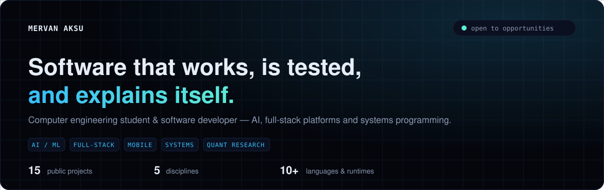
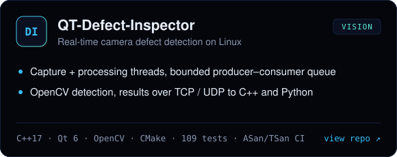
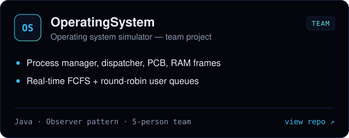
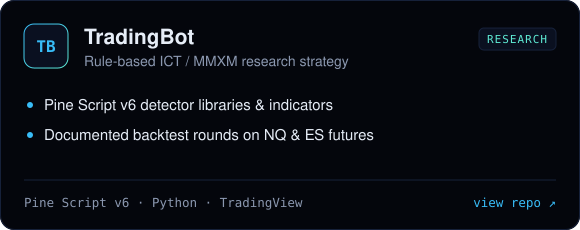
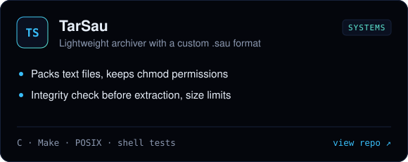
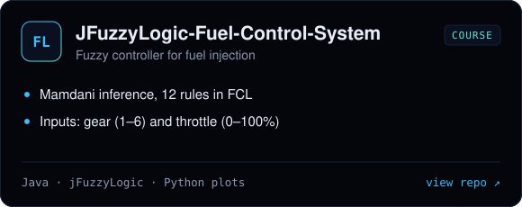

  

  
  
  

---

**01 — ABOUT**

### Building systems that have to hold up.

I'm a computer engineering student and software developer. I like taking an idea all the way to something people can actually use, with tests, documentation and honest limits written down.

- **Right now:** real-time defect detection with C++ / Qt / OpenCV ([QT-Defect-Inspector](https://github.com/mervanAksu/QT-Defect-Inspector)), rule-based trading research ([TradingBot](https://github.com/mervanAksu/TradingBot)), explainable financial analysis with RAG ([Finsight-AI](https://github.com/mervanAksu/Finsight-AI)) and booking platforms for local businesses.
- **Interests:** applied AI and machine learning · full-stack and mobile products · computer vision and industrial software in C++ · algorithmic trading research · systems programming in C.
- **How I work:** small, verifiable steps · readable code · every project ships with a README that says what it does *and* what it doesn't.

 

**02 — SELECTED WORK**

### Pinned projects.

<table>
  <tr>
    <td colspan="2" align="center"></td>
  </tr>
  <tr>
    <td width="50%"></td>
    <td width="50%"></td>
  </tr>
  <tr>
    <td width="50%"></td>
    <td width="50%"></td>
  </tr>
</table>

 

**03 — STACK**

### Tools I build with.

  
   
  

| Area | What I use |
|---|---|
| **AI / ML** | PyTorch · TensorFlow / Keras · scikit-learn · FinBERT · RAG · transfer learning |
| **Backend** | FastAPI · Node.js · ASP.NET Core MVC · Supabase Edge Functions (Deno) |
| **Frontend & mobile** | React · Next.js · TypeScript · Flutter · Windows Forms |
| **Data** | PostgreSQL (RLS, pg_cron) · SQLite · Drizzle · SQL Server |
| **C++ & desktop** | C++17 · Qt 6 (Widgets, signal/slot, QThread) · OpenCV · CMake · GoogleTest / Qt Test |
| **Systems & research** | C (OOP with function pointers, file formats) · Java · jFuzzyLogic · Pine Script v6 |

 

**04 — PORTFOLIO**

### Everything public, in one place.

| Project | What it is | Status |
|---|---|:-:|
| [**QT-Defect-Inspector**](https://github.com/mervanAksu/QT-Defect-Inspector) | Camera monitoring and fabric defect detection: multithreaded pipeline, OpenCV, TCP/UDP result publishing, 109 tests, sanitizer CI C++17 · Qt 6 · OpenCV · CMake | `ACTIVE` |
| [**OperatingSystem**](https://github.com/EreenKara/OperatingSystem) | OS simulator with process manager, dispatcher, memory frames and FCFS / round-robin scheduling (team of 5) Java | `TEAM` |
| [**TradingBot**](https://github.com/mervanAksu/TradingBot) | ICT / MMXM rule-based research strategy with documented backtests (no live trading) Pine Script v6 · Python | `RESEARCH` |
| [**TarSau**](https://github.com/mervanAksu/TarSau) | CLI archiver that packs text files into a custom `.sau` format, keeping permissions C · Make | `COURSE` |
| [**JFuzzyLogic-Fuel-Control-System**](https://github.com/mervanAksu/JFuzzyLogic-Fuel-Control-System) | Mamdani fuzzy controller estimating fuel injection from gear and throttle Java · jFuzzyLogic | `COURSE` |
| [**Finsight-AI**](https://github.com/mervanAksu/Finsight-AI) | Explainable financial analysis of SEC 10-K/10-Q/8-K filings: sentiment, risk diff, cited Q&A Python · FastAPI · React · TS | `ACTIVE` |
| [**Halisaha**](https://github.com/mervanAksu/Halisaha) | Pitch-booking platform: mobile app for players, web panel for owners, deposit payments Flutter · Next.js · Supabase | `ACTIVE` |
| [**BerberRandevuApp**](https://github.com/mervanAksu/BerberRandevuApp) | Turkish appointment app for independent barbershops Node.js · SQLite | `ACTIVE` |
| [**ML-Learning-Journey**](https://github.com/mervanAksu/ML-Learning-Journey) | ML projects from fundamentals up: Titanic, car prices, Fashion-MNIST, BBC news, transfer learning Python · PyTorch · Keras | `LEARNING` |
| [**SehirBolunmeSimulasyonu**](https://github.com/mervanAksu/SehirBolunmeSimulasyonu) | City → district → neighborhood simulation using OOP in plain C C | `COURSE` |
| [**CityPopulationSimulation**](https://github.com/mervanAksu/CityPopulationSimulation) | Round-based population growth and city splitting simulation Java · Maven | `COURSE` |
| [**DrawingGeometricShapesProgram**](https://github.com/mervanAksu/DrawingGeometricShapesProgram) | Drawing app with movable shapes and JSON save/load C# · WinForms | `COURSE` |
| [**BasicUnitConversionApp**](https://github.com/mervanAksu/BasicUnitConversionApp) | Menu-driven unit converter with input validation C# · .NET | `COURSE` |
| [**HospitalManagementSystem**](https://github.com/mervanAksu/HospitalManagementSystem) | Layered hospital management web app (models, repositories, services) ASP.NET Core MVC | `ARCHIVED` |
| [**WebProgramlamaProje**](https://github.com/mervanAksu/WebProgramlamaProje) | Airplane seat booking system ASP.NET MVC · JS | `ARCHIVED` |
| [**ProgramlamaDilleri**](https://github.com/mervanAksu/ProgramlamaDilleri) | Fighting-colonies simulation with OOP simulated in C C | `ARCHIVED` |
| [**Database-Management-Systems**](https://github.com/mervanAksu/Database-Management-Systems) | Cinema management desktop app for a DBMS course C# · SQL | `ARCHIVED` |

 

**05 — ACTIVITY**

### On GitHub.

  
  

 

**06 — CONTACT**

### Let's build something.

Open to internships, junior roles and collaboration on AI or full-stack projects. The fastest way to reach me is [LinkedIn](https://www.linkedin.com/in/mervan-aksu-9220831a3) or [email](mailto:mrvnn34@gmail.com).

© Mervan Aksu
